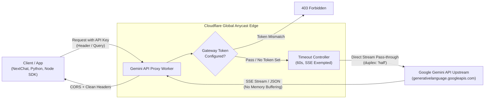

# Gemini API Proxy

[](https://workers.cloudflare.com/)
[](https://www.typescriptlang.org/)
[](https://opensource.org/licenses/MIT)
[](https://developers.cloudflare.com/workers/)

High-performance, zero-secret-leakage Cloudflare Worker reverse proxy designed for Google Gemini API (`generativelanguage.googleapis.com`), featuring native bidirectional `ReadableStream` SSE streaming, intelligent timeout circuit breaking, gateway anti-abuse shields, and full CORS preflight support.

---

## 🌟 Highlights & Architecture



### ⚡ Key Features

1. **Zero Secret Leakage (Scheme A)**
   - API keys are carried directly by clients via `x-goog-api-key`, `Authorization: Bearer ...`, or `?key=...`.
   - The Worker acts as a transparent relay and **never** hardcodes or logs sensitive keys.

2. **Native SSE Streaming & Zero Memory Buffering**
   - Direct `ReadableStream` streaming with `duplex: 'half'` request piping.
   - Zero `await request.text()` or `await response.json()` memory buffering, avoiding Cloudflare memory exhaustion.
   - Injects `Cache-Control: no-cache, no-transform` and `X-Accel-Buffering: no` for `:streamGenerateContent?alt=sse`.

3. **CORS & Multi-Client Compatibility**
   - Full support for `OPTIONS` preflight requests.
   - Comprehensive `Access-Control-Allow-*` headers supporting Web apps, Chatbox, NextChat, LobeChat, and OneAPI/NewAPI.

4. **Gateway Anti-Abuse Shield (`GATEWAY_TOKEN`)**
   - Optional environment secret `GATEWAY_TOKEN`.
   - Protects your Cloudflare Worker free tier quota from unauthorized scrapers while keeping transparent operation if unset.

5. **Sanitized Error Handling & Timeout Protection**
   - 60-second proactive timeout circuit breaker for non-streaming requests (streaming requests automatically exempted).
   - Sanitized 502 Bad Gateway and 504 Gateway Timeout JSON payloads, stripping internal infrastructure topologies and stack traces.

---

## 🚀 Quick Start

### 1. Prerequisites

- [Node.js](https://nodejs.org/) (v18 or later)
- [Cloudflare Account](https://dash.cloudflare.com/)
- [Wrangler CLI](https://developers.cloudflare.com/workers/wrangler/)

### 2. Local Setup

```bash
# Clone the repository
git clone https://github.com/your-username/gemini-api-proxy.git
cd gemini-api-proxy

# Install dependencies
npm install

# Verify TypeScript type checks
npm run type-check

# Run local development server
npm run dev
```

### 3. Deploy to Cloudflare

```bash
# Deploy to Cloudflare Workers
npm run deploy
```

Configure your custom domain in `wrangler.jsonc`:
```jsonc
{
  "$schema": "node_modules/wrangler/config-schema.json",
  "name": "gemini-api-proxy",
  "main": "src/index.ts",
  "compatibility_date": "2025-05-01",
  "compatibility_flags": ["nodejs_compat"],
  "workers_dev": true,
  "routes": [
    {
      "pattern": "your-proxy.example.com",
      "custom_domain": true
    }
  ],
  "observability": {
    "enabled": true
  }
}
```

---

## 🔒 Optional Security Shield

To guard your edge proxy against public discovery and unauthorized usage:

```bash
# Set secret on Cloudflare Workers
npx wrangler secret put GATEWAY_TOKEN
```

When configured, requests must provide the token:
- Via Header: `X-Gateway-Token: your-secret-token`
- Or via Query: `?gateway_token=your-secret-token` (the proxy strips this query param before forwarding to Google).

---

## 🛠️ Client Integration Examples

Replace `https://your-proxy.example.com` with your deployed Worker domain, and `YOUR_GEMINI_API_KEY` with your Google AI Studio API key.

### Python SDK (`google-genai`)

```python
from google import genai
from google.genai import types

client = genai.Client(
    api_key="YOUR_GEMINI_API_KEY",
    http_options=types.HttpOptions(
        base_url="https://your-proxy.example.com"
    )
)

response = client.models.generate_content(
    model="gemini-2.5-flash",
    contents="Hello from behind the proxy!"
)
print(response.text)
```

### Node.js / TypeScript SDK (`@google/genai`)

```typescript
import { GoogleGenAI } from '@google/genai';

const ai = new GoogleGenAI({
  apiKey: 'YOUR_GEMINI_API_KEY',
  httpOptions: {
    baseUrl: 'https://your-proxy.example.com',
  },
});

async function run() {
  const response = await ai.models.generateContent({
    model: 'gemini-2.5-flash',
    contents: 'Explain quantum computing in one sentence.',
  });
  console.log(response.text);
}

run();
```

### NextChat / Chatbox / LobeChat

- **API Host / Base URL**: `https://your-proxy.example.com`
- **API Key**: `YOUR_GEMINI_API_KEY`
- **Model**: `gemini-2.5-flash` / `gemini-2.5-pro`

### cURL

```bash
# Check health probe
curl -X GET "https://your-proxy.example.com/health"

# Generate content
curl -X POST "https://your-proxy.example.com/v1beta/models/gemini-2.5-flash:generateContent" \
  -H "Content-Type: application/json" \
  -H "x-goog-api-key: YOUR_GEMINI_API_KEY" \
  -d '{
    "contents": [{"parts": [{"text": "Hello world"}]}]
  }'
```

---

## 📄 License

This project is licensed under the [MIT License](LICENSE).
